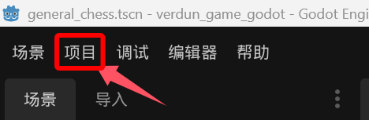
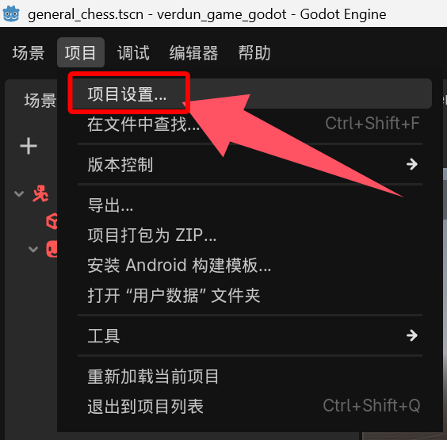
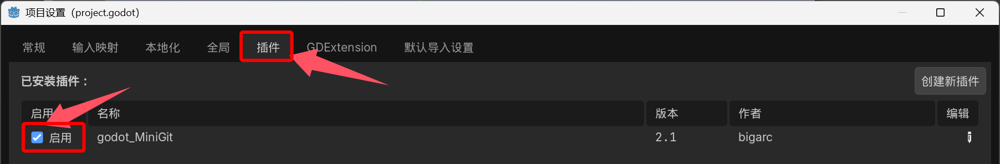
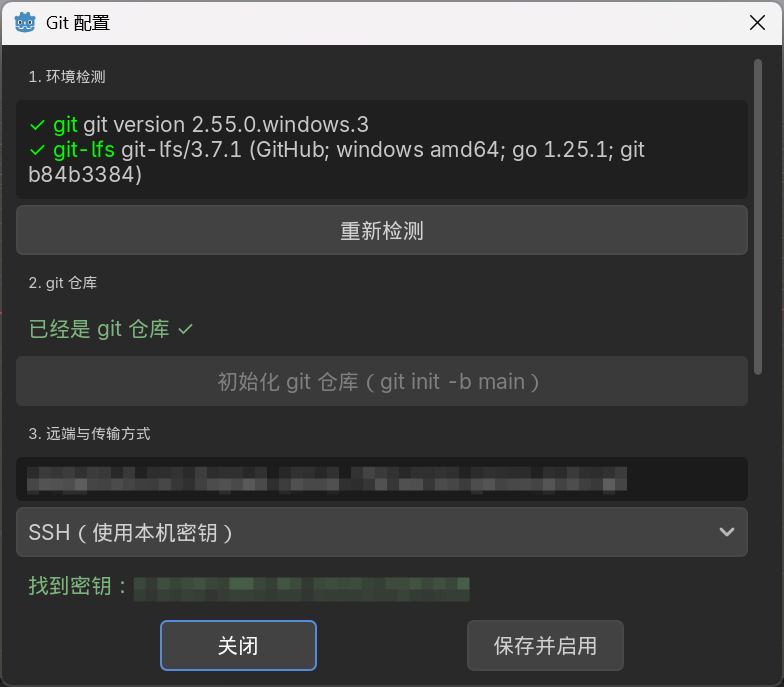
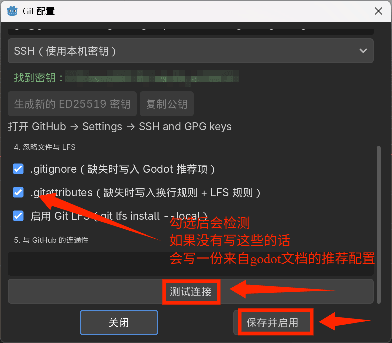
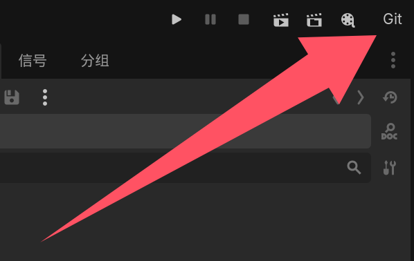

# minigit 设计说明

首先说明，这只是一个队内自用的git小工具，以方便成员协作，尤其是帮助不具有编程基础的成员。

当然，如果觉得确实有帮助，也欢迎任何人使用它。

## 0. 原则

1. **不保存任何凭据**。私钥、token、密码都不记录；HTTPS 交给 Git Credential Manager，SSH 交给 ssh-agent。
2. 所有会改变仓库状态的命令（init、写 .gitignore、改 remote）都先弹确认。
3. 界面上给出的每条 git 命令，都要能在终端原样粘贴执行——插件只是代劳。
4. 把 git 的英文报错映射成“下一步做什么”，并且保留原始输出在详情里。

## 1. 首次启用流程

实现上是一个配置窗口里的五个分节，而不是逐页向导——嵌套窗口越少越不容易卡在奇怪的状态里；每一节仍然独立，可以单独重试。

```
插件启用
  └─ 读本机配置（.git/minigit.cfg）
       ├─ 已配置 → 直接启用功能
       └─ 未配置 → 环境检查向导（只在首次自动弹，之后从菜单进入）
```

### 第 1 步：环境检查（只读，全部本地）

| 检查项 | 命令 / 判断 | 失败时 |
| --- | --- | --- |
| git 是否安装 | `git --version` | 显示安装指引（winget / 官网），后续步骤禁用 |
| 版本是否够用 | 解析版本号 ≥ 2.23（`git init -b`、`switch` 需要） | 提示升级 |
| git-lfs 是否安装 | `git lfs version` | 可继续，但“启用 LFS”选项灰掉 |
| 当前目录是否已是 git 仓库 | 存在 `.git` 且 `git rev-parse --is-inside-work-tree` 返回 true | 进入第 2 步 |
| 是否已有远端 | `git remote get-url origin` | 进入第 3 步 |
| 密钥是否存在 | `~/.ssh/id_ed25519`、`id_rsa`、`id_ecdsa` | 进入第 3 步时给 SSH 分支用 |

界面：一列带状态灯的清单，加一个“重新检测”。

### 第 2 步：纳入 git（仅当不是仓库）

弹窗：

> 当前项目还没有被 git 管理。要用 git 管理这个工程目录吗？
> 将执行：`git init -b main`（只建本地仓库，不连远端）

- 确定 → 执行 `git init -b main`，成功后刷新状态；
- 取消 → 结束向导，插件保持“未配置”状态，菜单里只剩“重新配置”。

### 第 3 步：远端与传输方式

输入框：仓库地址。两个单选：

- **SSH**（`git@github.com:用户/仓库.git`）
  - 检测到 `~/.ssh/id_*` → 直接进入连通性测试；
  - 没有密钥 → 两个选项：**生成新密钥**（`ssh-keygen -t ed25519 -C "<邮箱>" -f <路径> -N ""`）或**手动指定已有私钥路径**（设置 `core.sshCommand`）。
  - 生成后展示公钥全文 + “复制”，并给 `https://github.com/settings/keys` 的链接；提示**先加公钥再测连通性**。
- **HTTPS**（`https://github.com/用户/仓库.git`）
  - **首次推送由 Git Credential Manager 弹窗登录；插件只负责把 `credential.helper` 保持默认。**
  - **不提供“在插件里输入密码 / token”的入口。**

写入：`git remote add origin <url>`（已存在则 `git remote set-url origin <url>`）。

### 第 4 步：忽略文件与 LFS

检测两件事：

1. 项目根有没有 `.gitignore`、`.gitattributes`；
2. 已有的 `.gitattributes` 里有没有 `filter=lfs`。

缺失时给“使用 Godot 推荐配置”的复选框，展开预览要写入的内容：

- `.gitignore`：Godot 4 官方推荐项（`.godot/`、`/android/`、导出产物等），保留用户自己的行不动；
- `.gitattributes`：`* text=auto eol=lf` + 常用二进制走 LFS（png/jpg/webp/wav/ogg/glb/fbx/blend/ttf…）；
- 勾选“启用 LFS” → `git lfs install`（写 `.git/hooks`，只影响本仓库）。

**不覆盖已有文件**：存在就只提示“已存在，是否追加缺失项”，追加前显示 diff。

### 第 5 步：连通性测试

- 命令：`git ls-remote --heads origin`
- 环境：`GIT_TERMINAL_PROMPT=0`、SSH 时 `GIT_SSH_COMMAND=ssh -o BatchMode=yes -o ConnectTimeout=8`
- 结果三态：成功（列出分支数）/ 认证失败（密钥没加到 GitHub、agent 没起）/ 网络失败（DNS、代理、防火墙）
- 只有成功才允许“完成配置”。

### 第 6 步：完成

写配置（见下），工具栏按钮从“Git（未配置）”变成“Git”，菜单出现：提交并推送 / 仅推送 / 拉取 / 查看状态 / 重新配置。

## 2. 配置存放

`<项目>/.git/minigit.cfg`（`ConfigFile` 格式）：

```ini
[remote]
name="origin"
url="git@github.com:Togawa-group-TM/verdun_game_godot.git"
transport="ssh"

[lfs]
enabled=true

[state]
initialized=true
last_check="2026-10-20T20:00:00"
```

放 `.git/` 里：跟着仓库走、天然不被提交、换项目互不影响。没有 `.git` 时（向导第 2 步之前）不存在配置。

## 3. 命令表

| 动作 | 命令 | 备注 |
| --- | --- | --- |
| 检测仓库 | `git rev-parse --is-inside-work-tree` | 退出码判断 |
| 初始化 | `git init -b main` | 2.28+ 支持 `-b` |
| 远端 | `git remote add/set-url origin <url>` | 先查再改 |
| LFS | `git lfs install` | 每仓库一次 |
| 连通性 | `git ls-remote --heads origin` | 只读，不改仓库 |
| 提交 | `git add -A` + `git commit -m` | 沿用现有逻辑 |
| 推送 | `git push -u origin HEAD` | 首次设上游 |
| 拉取 | `git pull --ff-only` | 默认不自动产生 merge 提交 |

## 4. 线程与超时

连通性测试（`git ls-remote`，可能卡在 DNS/握手）放在 `Thread`，主线程只更新 UI，结果用 `call_deferred` 回到主线程。

v2.0 里提交、推送、拉取仍是同步执行：过程中编辑器会卡住，但不会出现“界面还在动、后台已经失败”的错觉。下一步把这三条也线程化，配合按钮禁用和结果回传。

- 超时：靠 `ConnectTimeout=8` + `BatchMode=yes`，而不是在客户端掐线程（`OS.execute` 无法中途取消）；
- 结果统一走 `_show_output()`，原始输出永远保留。

## 5. 失败信息映射

| git 原始报错                        | 给用户的话         | 下一步                           |
| ------------------------------- | ------------- | ----------------------------- |
| `Permission denied (publickey)` | GitHub 不认这把密钥 | 把公钥加到 GitHub，或检查 ssh-agent    |
| `Could not resolve host`        | 域名解析失败        | 检查网络 / 代理                     |
| `Authentication failed`         | HTTPS 凭据失效    | 让 Git Credential Manager 重新登录 |
| `not a git repository`          | 项目还没纳入 git    | 回到向导第 2 步                     |
| `git: command not found`        | 没装 git        | 给安装命令                         |

## 6. 文件拆分

```
addons/minigit/
├── plugin.cfg
├── minigit.gd      入口：工具栏、菜单、提交/推送/拉取、输出窗口
├── setup.gd         配置窗口：五节检查与操作，保存后发 configured 信号
├── git_runner.gd    执行 git、错误映射、只读连通性探测
├── env_check.gd     环境检测（git/lfs/repo/remote/SSH 密钥）
├── config.gd        读写 .git/minigit.cfg
├── templates.gd     .gitignore / .gitattributes 默认内容
└── DESIGN.md        本文件
```

## 7. 进度

- **P1 环境检测 + 配置读写 + 窗口骨架**：完成
- **P2 init / remote / 默认文件 / LFS 安装**：完成
- **P3 线程化连通性测试 + 错误映射**：完成（只覆盖 `ls-remote`）
- **P4 拉取与状态并入新 UI**：拉取、状态已完成；提交/推送线程化为下一步
- **P5 自定义按钮功能**：计划中，将硬编码按钮转换为可配置

## 8. 已定决策

- SSH 无密钥时：**允许一键生成 ED25519**（`ssh-keygen -t ed25519 -C <邮箱> -f ~/.ssh/id_ed25519 -N ""`），生成后显示公钥、可复制、给 GitHub 设置页链接；
- 默认 `.gitattributes`：**含 LFS 规则**，并执行 `git lfs install --local`；
- 配置位置：**`<项目>/.git/minigit.cfg`**；
- 拉取策略：**`git pull --ff-only`**。


## 9.安装与使用

- 1.安装  
	**将 addons 文件夹覆盖到工程根目录**  
	**或者将压缩包直接解压到根目录的 addons（如果没有的话就自己新建一个）**
- 2.使用
	现在打开你的工程，打开左上角项目，在下拉窗口中打开项目设置  
	  
	  
	在新弹窗的插件选项中启用插件  
	  
	在配置中配置各个属性：  
	  
	  
	然后你就可以用了：  
	
